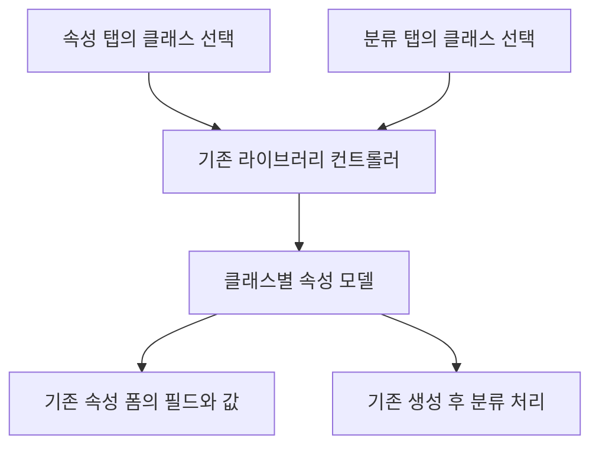

# CA 클래스 선택과 속성 입력: 변경한 코드의 동작 원리

이 기능은 속성 탭에서 클래스를 선택하고, 그 클래스의 속성 필드와 값 입력창도 속성 탭에서 사용할 수 있게 합니다. 현재는 기존 분류 속성 폼을 속성 탭으로 옮기는 **move 동작만** 제공합니다. 두 탭에 별도 폼을 두는 both 방식은 요구사항 확정 전까지 보류합니다.

핵심은 **기존 분류 컨트롤러와 속성 모델을 계속 사용하면서 선택 UI와 폼의 표시 위치를 연결하는 것**입니다. 서버 타입 정의, 클래스 선택 상태, 선택창의 칩, 클래스 속성 모델, 화면에 붙은 폼은 서로 다른 역할을 합니다. 어떤 역할을 유지하고 어떤 역할을 연결하는지를 이해하면 코드가 이렇게 바뀌는 이유를 알 수 있습니다.

구체적인 삽입 위치는 각 JS 파일의 주석에 있습니다. 이 README는 교체 순서보다 각 변경의 이유와 실행 흐름을 설명합니다. 코드는 공개 2024x 소스를 참고한 수정 조각이며, 실제 설치 버전에서의 표시·값 커밋·영구 저장은 따로 확인해야 합니다.

## 소스 주석을 읽는 방법

각 JS의 함수 앞 주석은 인자·역할·필요한 이유를 설명하고, 주요 처리 앞 주석은 모델/표시/UI 수명에서 그 코드가 담당하는 부분을 설명합니다. 나중에 기능을 수정할 때는 해당 함수의 주석과 아래 전체 흐름을 함께 보시면 됩니다. 주석 보강 이후 로그인 사용자 조회와 동적 파라미터 공급을 추가했습니다. 분류 탭의 라이브러리 선택창 숨김은 ClassificationsFacet.js에서 오늘 적용한 한 줄의 위치와 영향 범위를 주석으로 설명했습니다.

## 1. 기존 생성 화면은 어떻게 구성되는가

CA 생성 버튼을 누르면 Change Governance의 생성 함수가 타입과 컨텍스트 등을 구성하고 ENONew 생성 인프라에 전달합니다. ENONew는 facet 목록을 만들고, 각 facet의 모듈을 로딩하여 탭을 구성합니다.

| 구성 요소 | 기존 역할 | 이번에 연결한 부분 |
|---|---|---|
| `ChgCreateChangeAction` | 생성할 타입과 컨텍스트, 생성 후 동작 설정 | 적용 범위와 기본 타입 설정 저장 조건 |
| `ENONewFacetHelper` | 속성·분류 facet의 정의와 옵션 구성 | 같은 대화상자의 두 facet에 공유 bridge 전달 |
| `ENOListViewFacet` | 일반 속성 입력 폼 표시 | 클래스 선택창과 기존 클래스 속성 폼의 표시 영역 |
| `PLMNewClassificationFacet` | 분류 UI 초기화 및 생성 후 분류 처리 | 라이브러리 컨트롤러를 bridge에 연결 |
| `PLMNewLibraryActiveController` | 클래스 검색·선택 및 분류 속성 모델 관리 | 새 선택창도 이 컨트롤러를 사용 |
| `ENONewDialogController` | 대화상자 및 탭 전환·종료 처리 | 종료 시 bridge 정리 |

`ENOCreate`는 기본 속성 facet의 이름이고, `classificationFacet`은 분류 facet의 이름입니다. 이름은 해당 facet을 찾기 위한 식별자입니다. `ENONewWidget.js`에는 여러 AMD 모듈이 들어 있으므로 같은 파일 안이라도 각 factory의 변수 범위는 다릅니다. 예를 들어 getFacetList의 지역변수 `a`를 다른 factory에서 사용할 수는 없습니다.

## 2. 타입 상속과 클래스 선택은 왜 별개의 작업인가

Change Action을 상속한 새 타입은 서버 데이터 모델에서 새로운 업무 객체 종류를 정의하는 것입니다. 반면 생성 화면에서 라이브러리의 클래스를 선택하는 것은 그 객체를 특정 클래스에 분류하고 해당 클래스의 속성을 입력하기 위한 작업입니다.

타입을 상속해도 속성 탭에 클래스 선택 UI가 자동으로 생기는 것은 아닙니다. 타입 정의는 어떤 업무 객체를 만들지 결정하고, 생성 화면의 facet과 컨트롤러는 사용자가 무엇을 어디에서 입력할지 결정합니다.

또한 라이브러리 선택창의 표시 문자열을 일반 attribute로 저장하는 것과 실제 클래스에 객체를 분류하는 것은 다릅니다. 이 구현은 클래스를 선택한 ID와 기존 분류 로직을 사용합니다. 클래스 속성은 해당 분류 모델을 통해 관리합니다.

기본 `Change Action`으로 화면 동작을 시험할 수도 있습니다. 새 타입의 생성 정책·서비스 지원을 검증하는 작업과 UI 연결을 확인하는 작업을 구분할 수 있기 때문입니다. 현재 JS 예시의 신규 타입명과 위젯 활성화 조건은 예시 설정이므로, 사용자가 적용한 `Change Action` 조건은 그대로 유지할 수 있습니다.

## 3. bridge는 어떤 문제를 해결하는가

속성 facet과 분류 facet은 각각 생성되는 객체입니다. 속성 facet의 초기화 함수에서 분류 facet의 컨트롤러 변수를 직접 참조할 수 있는 구조가 아닙니다. 두 facet이 같은 생성 대화상자에 속한다는 사실만으로 서로의 지역변수가 공유되지는 않습니다.

그래서 facet 목록을 만드는 시점에 bridge를 하나 만들고 두 facet의 options에 같은 객체 참조를 넣습니다.

```javascript
properties.options.zcaBridge === classification.options.zcaBridge
// 같은 생성 대화상자에서는 true
```

bridge는 독립적인 클래스 선택 데이터를 한 벌 더 저장하지 않습니다. 준비된 기존 라이브러리 컨트롤러의 참조를 보관하고, 그 컨트롤러의 현재 선택을 읽으며, 변경이 생기면 구독자에게 알려 줍니다.

따라서 속성 탭은 bridge를 통해 기존 분류 컨트롤러에 접근할 수 있습니다. 생성 대화상자마다 bridge를 새로 만드는 이유는 한 대화상자의 선택이나 종료 상태가 다른 대화상자에 섞이지 않도록 하기 위해서입니다. 전역 객체에 선택 목록을 두는 방식과 달리 공유 범위가 현재 대화상자의 두 facet으로 한정됩니다.

## 4. getFacetList가 끝날 때 bridge를 연결하는 이유

getFacetList는 먼저 기본 속성 facet을 만들고, 요청받은 분류 등의 facet을 추가하여 최종 배열을 구성합니다. 배열 구성이 끝나야 `ENOCreate`와 `classificationFacet`을 둘 다 찾을 수 있습니다.

이때 각 facet의 options에 bridge를 넣으면 이후 인프라가 facet 인스턴스를 생성하면서 같은 참조를 전달합니다. 그래서 zcaAttachBridge는 최종 배열이 만들어진 뒤, 배열이 반환되기 전에 실행됩니다.

호출 위치가 함수 밖이면 지역변수인 배열을 찾지 못합니다. 배열을 다 만들기 전에 호출하면 분류 facet이 아직 없어서 연결되지 않을 수 있습니다. 이 연결이 누락되면 속성 facet의 options.zcaBridge는 undefined이므로 새 선택 UI를 만들지 않습니다.

## 5. 컨트롤러 준비를 기다리는 이유

분류 facet 객체가 생성되어도 내부 라이브러리 컨트롤러와 AutoComplete가 즉시 준비되는 것은 아닙니다. 기존 초기화 코드가 다른 모듈을 비동기로 로딩하기 때문입니다.

zcaConnectClassificationFacet는 기존 initUI에서 라이브러리 컨트롤러와 자동완성 컴포넌트가 준비되는지 확인하고 bridge에 연결합니다. 속성 탭의 선택창은 그 전까지 비활성화됩니다. 준비되지 않은 컨트롤러로 검색하거나 선택 노드를 추가하는 일을 막기 위해서입니다.

`alwaysCalled`는 분류 facet의 백그라운드 초기화에 사용되는 기존 설정입니다. 현재 설치 버전에서도 분류 탭을 열지 않고 초기화가 실행되는지는 확인해야 합니다. 설정을 넣었다는 사실만으로 모든 버전의 로딩 시점이 같다고 볼 수는 없습니다.

## 6. 클래스를 선택하면 속성 필드는 어떻게 생기는가

속성 탭에서 선택해도 실제 분류 상태를 변경하는 주체는 기존 라이브러리 컨트롤러입니다.



ZcaLibraryAdapter는 클래스 경로를 조회하고 선택 노드를 기존 자동완성 모델에 추가한 뒤 `select()`를 실행합니다. 기존 선택 변경 이벤트가 그 결과를 받아 클래스별 ClassifPropModel을 만들고 분류 속성을 조회·표시합니다.

즉 선택한 클래스의 이름을 문자열로 넣어서 필드가 생기는 것이 아닙니다. **기존 클래스 선택 이벤트를 실행했기 때문에 기존 속성 조회·폼 생성 로직이 이어지는 것**입니다. `selectedItems`에 배열만 넣는 것과 구분해야 하는 이유도 여기에 있습니다.

최종 선택 대상은 `General Class`입니다. 라이브러리 루트의 이름만 선택한 상태는 특정 클래스의 속성 필드를 만들기 위한 클래스 선택과 다릅니다. 선택한 클래스의 필드가 나타나는 것이며, 다른 객체에 저장된 값을 자동으로 복사하는 기능은 아닙니다.

기존 클래스 경로 서비스는 같은 종류의 겹치는 요청을 취소하는 코드가 있으므로 추가 선택은 순서대로 처리합니다. 검색은 WUX AutoComplete가 담당하고, 클래스 연결용 노드 추가는 adapter가 담당합니다.

## 7. 선택 UI는 왜 WUX로 바꾸었는가

기본 HTML input과 button으로도 검색과 선택 로직을 연결할 수 있지만, 기존 분류 화면의 칩·아이콘·배치와 다른 외형이 됩니다. 그래서 기존 분류 탭과 같은 WUXAutoComplete, Controls/Button, TooltipModel, NLS, CSS 클래스를 사용합니다.

이 변경은 선택 결과를 관리하는 컨트롤러를 새로 만드는 작업이 아닙니다. 사용자가 조작하는 선택 UI를 기존 UI 계열로 맞추는 작업입니다. 검색/선택이 최종적으로 기존 분류 컨트롤러에 반영된다는 구조는 유지됩니다.

WUX 선택창에서 칩을 삭제하면 현재 선택 목록의 차이를 구해 기존 컨트롤러의 선택 노드를 `unselect()`합니다. 기존 분류 로직이 그 클래스의 속성 모델과 필드 제거를 처리합니다. 반대로 분류 탭에서 선택이 바뀌면 bridge 구독자가 속성 탭의 칩 표시를 갱신합니다.

## 8. 선택 칩은 복제하면서 속성 폼은 복제하지 않는 이유

| 대상 | 처리 방식 | 이유 |
|---|---|---|
| 두 선택창의 TreeNodeModel | 클래스 ID에 대응하는 표시용 노드를 각 UI에 별도로 둠 | 같은 선택 노드를 두 UI가 직접 관리하면 노드 선택·해제 이벤트가 서로의 UI 상태를 바꿀 수 있음 |
| 선택한 클래스 목록 | 기존 분류 컨트롤러의 목록을 기준으로 사용 | 두 목록이 각각 업무 상태가 되는 것을 방지 |
| 클래스 속성 모델과 입력 폼 | 기존 인스턴스를 재사용 | 기존 입력값, 필드 이벤트, 모델의 변경값과 저장 연결을 유지 |

칩에 보이는 노드와 분류 속성 데이터는 서로 다른 것입니다. 칩용 노드를 새로 만들어도 같은 클래스 ID를 표시할 수 있습니다. 하지만 속성 폼의 DOM만 clone하면 기존 tweaker 이벤트와 속성 모델까지 같은 동작으로 복제되는 것은 아닙니다. 반대로 속성 모델을 두 벌 만들면 변경값과 저장을 동기화하는 별도의 설계가 필요합니다.

현재 구현은 선택 UI의 노드는 분리하고, 실제 클래스 속성 데이터와 편집 폼은 기존 것을 유지합니다.

## 9. move 동작에서 속성 탭에 값 입력창이 나타나는 이유

기존 라이브러리 컨트롤러의 `accordeonCon`에는 ClassifPropWidget이 주입되어 있습니다. 이 컨테이너 안에 클래스 속성의 실제 입력 폼이 있습니다.

zcaRenderClassFields는 이 컨테이너를 속성 탭의 표시 영역에 붙입니다. 이때 클래스 속성 필드를 새로 만들거나 값을 복사하지 않습니다. 이미 이벤트와 모델이 연결된 같은 폼의 부모 DOM을 바꾸는 것입니다.

현재는 모드 선택 옵션 없이 항상 move 동작을 사용합니다.

`move`에서는 이 폼이 속성 탭에 머무릅니다. 사용자는 클래스 선택창 아래에서 속성값을 편집하고, 분류 탭은 기존 클래스 선택 기능을 사용할 수 있지만 해당 속성 폼은 속성 탭에 표시됩니다.

아직 클래스가 선택되지 않았다면 속성 탭의 폼 표시 영역은 숨깁니다. 이후 클래스가 선택되어 기존 폼에 필드가 생성되면 그 필드가 속성 탭에서 보입니다. 화면에서 보이는 위치가 바뀌어도 컨트롤러의 모델·폼 참조는 같은 객체를 가리킵니다.

## 10. 탭 전환과 폼의 표시 위치를 분리하는 이유

현재 move 동작은 폼의 표시 위치를 속성 탭에 고정합니다. 분류 탭으로 전환해도 클래스 속성 폼을 그 탭으로 돌려보내지 않습니다. 그래서 활성 탭 이름을 bridge에 전달하는 추가 함수나 탭 전환 호출이 필요하지 않습니다. 분류 탭의 기존 클래스 선택 기능은 유지되며, 선택 결과는 기존 분류 컨트롤러를 통해 속성 탭의 필드에도 반영됩니다.

화면을 닫을 때 원래 부모로 돌려놓는 처리는 그대로 필요합니다. 이는 다른 탭에서 편집하도록 하기 위한 처리가 아니라 기존 컴포넌트의 소유와 정리 경로를 유지하기 위한 처리입니다.

이전에 붙인 zcaSelectFieldsTab 호출과 함수, zcaClassFieldsMode 설정은 이번 버전에서 제거됩니다. 기존 onTabChange의 manageButtons 등 일반 탭 처리는 유지합니다. 현재 코드에는 both 분기나 두 탭 사이 폼 이동이 없습니다.

## 11. blur, 높이, resize 처리가 필요한 이유

입력창에 보이는 값이 항상 즉시 속성 모델에 커밋되는 것은 아닙니다. tweaker에 따라 포커스를 잃을 때 편집값을 확정할 수 있으므로, 폼을 옮기기 전에 활성 입력창에 blur를 실행하여 값 커밋 기회를 줍니다. 실제 값 커밋 시점은 설치 환경의 필드 종류별로 확인해야 합니다.

ClassifPropWidget의 내부 컨트롤은 부모 영역의 크기를 이용해 레이아웃을 계산합니다. 새 표시 영역에 높이를 부여하고, 폼 이동 뒤 기존 onInnerResize를 호출하는 이유는 바뀐 부모 크기로 레이아웃을 다시 계산하게 하기 위해서입니다. 현재 360px는 코드의 표시 영역 기본 높이이며 서버 데이터나 클래스 속성 수를 뜻하지 않습니다.

이 처리는 표시와 편집을 위한 것입니다. 서버에 속성값을 저장하는 호출은 아닙니다.

## 12. 폼이 속성 탭에 있어도 저장은 어떻게 이어지는가

기본 속성 facet은 기존 CA 생성 입력을 처리합니다. 분류 facet은 생성된 객체 ID를 받은 뒤 기존 postCreation 경로에서 클래스 연결과 분류 속성 저장을 수행합니다.

이번 코드가 폼의 표시 위치를 바꾸어도 classifPropModels와 classifPropertiesView를 새로 만들지 않으므로 기존 분류 처리 경로가 같은 모델과 폼의 변경값을 참조할 수 있습니다. 속성 탭에 폼을 붙였다는 이유로 기본 속성 저장 요청에 분류 속성을 임의로 추가하지 않습니다.

**클래스 선택 성공, 속성 필드 표시, 값의 모델 반영, 서버 저장 완료는 서로 다른 단계입니다.** 참고 소스의 postCreation은 내부 속성 저장 완료를 기다리는 방식과 실패 전파를 추가 확인해야 합니다. 이 변경만으로 저장의 성공·실패 처리가 강화된 것은 아닙니다.

생성 후 분류 저장이 실패하면 CA는 이미 만들어져 있을 수 있습니다. 그래서 완료 메시지뿐 아니라 실제 객체를 다시 열어 분류 연결과 입력값을 확인해야 합니다. 실패 재시도에서 새 CA를 중복 생성하지 않는 처리도 별도로 고려해야 합니다.

## 13. 다른 위젯에 대한 조건과 기본 타입 저장을 구분하는 이유

공용 JS 파일은 여러 위젯이 로드할 수 있습니다. 저장소 예시는 위젯 활성화 값과 타입 조건을 확인한 뒤 현재 대화상자의 facet에만 bridge를 붙입니다. bridge가 없는 속성 facet은 새 UI를 추가하지 않습니다.

현재 테스트처럼 타입 비교만 남겨 `Change Action`에 적용하면 위젯을 구분하는 조건은 사라집니다. 같은 타입의 생성 화면에서도 조건을 통과할 수 있다는 뜻입니다. 타입 조건만으로 특정 위젯 전용 동작이 보장되지는 않습니다.

CA_DEF_TYPE 사용자 설정은 방금 생성한 타입을 다음 생성의 기본값으로 저장하는 설정입니다. 이 설정에 커스텀 타입을 저장하면 다음 생성 화면의 기본 선택에도 영향을 줄 수 있으므로, 원래 예시는 커스텀 생성 경로에서 해당 저장 호출을 제외합니다. 이는 폼 표시 조건과 별개의 부작용을 줄이기 위한 변경입니다.

타입 생성은 서버 공용 스키마 변경이고, bridge와 폼 위치는 클라이언트 화면 변경입니다. 위젯 UI에 조건을 넣어도 신규 타입 자체가 다른 검색·하위 타입 목록에서 사라지는 것은 아닙니다.

또한 실제 iframe/AMD 실행 문맥의 분리 여부가 중요합니다. 기존 분류 유틸리티에는 singleton/provider 상태가 있으므로, 같은 실행 문맥에서 여러 분류 화면을 동시에 여는 경우에는 추가 검토가 필요합니다.

## 14. 종료 시 원래 위치로 돌려놓는 이유

속성 탭의 표시 영역은 이번에 추가한 UI이지만, 그 안의 클래스 속성 폼은 기존 분류 컴포넌트가 소유하던 객체입니다. 표시 영역을 지우기 전에 기존 폼을 원래 부모와 순서로 되돌려 놓아야 기존 컴포넌트의 수명과 정리 경로를 유지할 수 있습니다.

zcaRestoreClassFields가 원래 위치를 복원하고, zcaDestroyPropertiesPicker가 추가한 WUX 컨트롤과 구독을 정리합니다. bridge를 dispose하면 진행 중인 추가 처리에서 종료 상태를 확인하여 닫힌 화면에 다시 선택을 반영하지 않도록 합니다.

화면을 닫는 것과 이미 생성한 CA를 취소·삭제하는 것은 다릅니다. 이 정리 코드는 화면 객체와 구독의 수명을 관리하는 것이며 서버 객체를 삭제하지 않습니다.

## 15. 선택창 파라미터는 왜 수신 로직까지 필요한가

zcaSelectorParameters는 선택창에 전달할 값을 담는 추가 코드의 옵션이고, zcaOpenClassSelector는 그 값을 받아 실제 선택창을 여는 연결 함수입니다. 둘 다 OOTB에 원래 존재하는 옵션명은 아닙니다.

파라미터를 전달했다고 선택창의 검색 범위나 초기 선택이 자동으로 달라지는 것은 아닙니다. 기본 onClickSelector가 인자를 처리하지 않기 때문입니다. 실제 검색 범위 제한이나 초기 클래스 지정은 LibraryActive 생성 옵션 또는 검색 요청 조건에서 그 값을 사용하는 수신 로직이 있어야 합니다.

즉 현재 추가한 부분은 전달 지점입니다. libraryId나 classId가 어떤 의미로 쓰일지는 요구사항과 설치 버전의 지원 옵션에 맞춰 구현해야 합니다.

### 로그인 사용자 정보를 동적으로 전달하는 방법

`zcaAttachBridge()`는 속성 facet에 `zcaGetSelectorParameters` 공급 함수를 등록합니다. 커스텀 수신 함수가 연결된 경우 찾아보기 버튼을 누르면 이 공급 함수를 호출하고, 사용자 조회가 완료된 뒤 `zcaOpenClassSelector(controller, parameters)`에 전달합니다. 객체 또는 Promise를 반환하는 별도 공급 함수로 바꾸는 것도 가능합니다.

조회 경로는 Compass의 `getServiceUrl` → WAFData의 `authenticatedRequest` → `GET /resources/modeler/pno/person?current=true&select=preferredcredentials`입니다. 예시 사용자 변수를 사용하지 않습니다. 사용자 조회는 커스텀 수신 함수가 있을 때만 실행하며 일반 browse는 유지합니다.

`ENONewWidget.js`의 `zcaAttachBridge()`에서 `properties.options.zcaBridge = bridge;` 아래에 다음 수신 함수를 연결할 수 있습니다. 주석 위치에서 전달받은 정보를 실제 선택창 생성 옵션/검색 조건으로 사용합니다.

```js
properties.options.zcaOpenClassSelector = function (controller, parameters) {
    // parameters.userName: 현재 로그인 사용자의 계정명
    // parameters.currentUser: API가 반환한 현재 사용자 객체
    // parameters.preferredCredentials: 사용자의 기본 권한 문맥
    // parameters.securityContext: 해당 속성 facet으로 전달된 현재 권한 문맥
    // parameters.tenant: 현재 플랫폼 ID
    // 사용자별 필터가 필요하면 이 위치에서 선택창 생성/검색 로직에 적용합니다.
    controller.onClickSelector();
};
```

위 코드는 실제 사용자 조회와 수신까지 동작하는 연결 예제입니다. 마지막 `onClickSelector()`는 기존 선택창을 열며 파라미터를 사용하지 않습니다. 사용자에 따라 라이브러리 범위를 제한하려면 마지막 호출을 설치 버전의 선택창 생성/검색 구현으로 수정해야 합니다. 사용자별 라이브러리 매핑 규칙은 이번 작업에서 정하지 않았습니다.

고정·동적 업무값은 기존 `properties.options.zcaSelectorParameters` 객체에 추가하면 사용자 정보와 함께 전달됩니다. `userName`, `currentUser`, `preferredCredentials`, `securityContext`, `tenant`는 조회 결과용 키이므로 공급 함수가 덮어씁니다. API의 응답 구조는 `data[0].name` 기준으로 확인하며 구조가 다르거나 조회가 실패하면 상태 메시지를 표시하고 선택창을 열지 않습니다. 조회 중 중복 클릭을 막고, 화면이 닫힌 뒤 도착한 응답도 선택창을 열지 않도록 처리합니다.

`preferredCredentials`는 기본 권한이며 현재 선택한 organization과 일치한다고 가정하지 않습니다. 현재 문맥이 필요하면 facet의 `securityContext`를 사용해야 합니다. 사용자 정보 파라미터는 검색 동작에 사용할 데이터이고 서버 권한 검사를 대체하지 않습니다.

참고: [Dassault CAA의 3DSpace REST 설명(문서 미러)](https://library.plmcoach.com/caa3dx/win_b64.doc/English/CAA3DSpaceREST/CAAi3DXTa3DSpaceWService.htm). 실제 설치 환경의 사용자 API 응답과 선택창 필터는 통합 검증이 필요합니다.

## 16. 함수별로 보면 무엇을 담당하는가

| 함수 | 담당하는 일 | 이 함수가 필요한 이유 |
|---|---|---|
| zcaCreateBridge | 대화상자별 연결 객체 생성 | 두 facet을 연결하면서 대화상자 사이 상태를 분리 |
| zcaAttachBridge | 적용 조건 검사와 공유 참조 전달 | 생성 인프라가 각 facet에 같은 연결을 전달하게 함 |
| zcaConnectClassificationFacet | 기존 컨트롤러 준비 확인·연결 | 비동기 초기화 완료 전에 선택을 실행하지 않게 함 |
| ZcaLibraryAdapter | 검색·선택을 기존 컨트롤러에 전달 | 기존 클래스 속성 모델 생성 이벤트를 재사용 |
| zcaInstallPropertiesPicker | WUX 선택 UI와 속성 표시 영역 구성 | 기본 속성 폼에 클래스 선택/편집 공간을 제공 |
| zcaRenderClassFields | 기존 폼을 속성 탭에 배치 | 입력값과 모델을 유지한 채 표시 위치 변경 |
| zcaRestoreClassFields | 기존 폼의 원래 부모·순서 복원 | 기존 컴포넌트의 소유/정리 경로 유지 |
| zcaDestroyPropertiesPicker | 추가 UI와 구독 정리 | 닫은 화면의 컨트롤·리스너를 남기지 않음 |
| zcaDisposeDialogBridge | 대화상자의 bridge 종료 | 두 facet에 같은 종료 상태 전달 |

## 17. 근거와 확인 범위

참고한 공개 소스:

- https://github.com/Ignim94/R2024x/blob/master/3dspace/webapps/ENONewWidget/ENONewWidget.js
- https://github.com/Ignim94/R2024x/blob/master/3dspace/webapps/ClassificationsFacet/ClassificationsFacet.js
- https://github.com/Ignim94/R2024x/blob/master/3dspace/webapps/PLMNewLibraryActive/PLMNewLibraryActive.js
- https://github.com/Ignim94/R2024x/blob/master/3dspace/webapps/ClassificationProp/ClassificationProp.js
- https://github.com/Ignim94/R2024x/blob/master/3dspace/webapps/ENOChgGovernanceUX/ENOChgGovernanceUX.js

기존 모듈의 내부 필드는 공식 확장 API로 보장되는 것이 아닙니다. 설치 버전에 따라 변수명, 초기화 순서, 컨테이너, 속성 저장 경로가 달라질 수 있습니다. 로컬 대역 검사는 참조 공유와 폼 이동의 코드 동작을 확인한 것이며, 실제 WUX/tweaker 및 서버 저장의 통합 검증은 아닙니다. 검사 범위는 [VALIDATION.md](VALIDATION.md)에 구분해 두었습니다.


